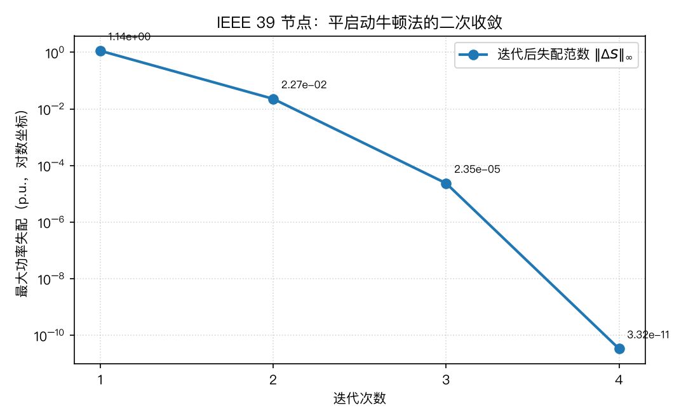

# 2.8 ~ 2.12　求解实战：PYPOWER、收敛过程与交叉验证

> PYPOWER 求解代码、为什么只迭代 1 次、平启动的二次收敛、Pandapower

## 2.8 用 PYPOWER 求解（主路径）

这就是你的问题里说的"一般是用 pypower 那个仓库去做"。**核心只有 6 行**：

```python
from pypower.api import case39, runpf, ppoption

ppc = case39()                                  # 1. 读算例

options = ppoption(                             # 2. 设置求解选项
    VERBOSE=1,        # 打印求解过程
    OUT_ALL=0,        # 不打印完整结果表
    PF_ALG=1,         # 1 = 极坐标牛顿法（Newton-Raphson）
    PF_TOL=1e-10,     # 3. 收敛容差
    PF_MAX_IT=20,     # 4. 最大迭代次数
)

result, success = runpf(ppc, options)           # 5. 求解
print(success)                                  # 6. True 表示收敛
```

### `ppoption` 常用参数详解

| 参数 | 取值 | 说明 |
|---|---|---|
| `PF_ALG` | 1 | 牛顿法（极坐标）——**默认，最常用** |
| | 2 | 快速解耦法 XB 版本 |
| | 3 | 快速解耦法 BX 版本 |
| | 4 | 高斯-赛德尔法（只适合教学，慢） |
| `PF_TOL` | 1e-10 | 失配容差（标幺值）。**默认 1e-8**，本教程收紧到 1e-10 |
| `PF_MAX_IT` | 20 | 牛顿法最大迭代次数（默认 10） |
| `VERBOSE` | 1 | 打印算法名和收敛信息；0 = 静默 |
| `OUT_ALL` | 0 | 不打印结果表；1 会打印一大堆 |

### 实际输出

```text
PYPOWER Version 5.1.21, 01-Aug-2026 -- AC Power Flow (Newton)

Newton's method power flow converged in 1 iterations.

收敛标志 success = 1
母线电压幅值范围 : 0.9820 ~ 1.0636 pu
母线电压相角范围 : -14.5353° ~ 4.4684°
```

**"1 iterations" 是正常的**，原因见 1.11 节 ①。

### 返回的 `result` 里有什么

`result` 是一个字典，键和输入 `ppc` 一样，但里面的数值已经是**求解后**的：

| 键 | 内容 |
|---|---|
| `bus` | 第 7、8 列已更新为求解出的 `VM`、`VA` |
| `gen` | 第 1、2 列已更新为求解出的 `PG`、`QG` |
| `branch` | 第 13 ~ 16 列填入了 `PF`、`QF`、`PT`、`QT`（支路潮流） |
| `success` | 1 表示收敛 |
| `et` | 求解耗时，秒 |

> **一个坑**：`result` **没有** `iterations` 字段（`result.get('iterations')`
> 返回 `None`）。迭代次数只在 `VERBOSE=1` 时打印出来。想程序化拿到迭代次数，
> 就得自己调用底层的 `newtonpf`，或者用 2.10 节的自研求解器。

## 2.9 为什么这个算例只迭代 1 次？

这不是牛顿法的问题，而是**这个算例的初值太好了**。

回顾 1.11 节 ① 的实测：

```text
初值处的最大功率失配 = 2.91e-05 pu
```

牛顿法第一步就把 2.91e-05 的失配降到了 7.90e-13（见下节表格第 1 行），
远小于容差 1e-10，于是立刻收敛。

**所以"1 次迭代"反而说明这个算例自带的数据是一个已经解好的潮流。**
很多教材和数据集都会这样处理——先给出一个解，方便别人检查自己的程序对不对。

## 2.10 平启动实验：看到真正的收敛过程

要观察牛顿法的收敛行为，必须把初值"抹掉"，改成**平启动（flat start）**：

$$V_i = 1.0 \ \text{pu}, \qquad \theta_i = 0 \quad (\text{所有母线})$$

代码：

```python
import copy
import numpy as np
from pypower.idx_bus import VM, VA

flat = copy.deepcopy(ppc)
flat["bus"] = np.asarray(flat["bus"], dtype=float)
flat["bus"][:, VM] = 1.0     # 所有母线电压幅值设为 1.0
flat["bus"][:, VA] = 0.0     # 所有母线电压相角设为 0

result_flat, success_flat = runpf(flat, options)
```

用自研求解器跑平启动，把每次迭代的失配记录下来：

```text
  迭代      迭代前失配范数        最大修正量      迭代后失配范数     下降倍数
   1     8.128725e+00     2.367454e-01     1.137114e+00        -
   2     1.137114e+00     4.732528e-02     2.273135e-02      5.0e+01
   3     2.273135e-02     1.928426e-03     2.347430e-05      9.7e+02
   4     2.347430e-05     2.106159e-06     3.317585e-11      7.1e+05
```

**请仔细看"迭代后失配范数"这一列：**

```text
1.14e+00  →  2.27e-02  →  2.35e-05  →  3.32e-11
```

每迭代一次，误差的**指数**大约翻倍（有效数字翻倍）：

| 迭代 | 失配范数 | 有效数字位数 |
|---:|---:|---:|
| 1 | 1.14e+00 | 0 位 |
| 2 | 2.27e-02 | 约 2 位 |
| 3 | 2.35e-05 | 约 5 位 |
| 4 | 3.32e-11 | 约 11 位 |

这就是**二次收敛（quadratic convergence）**的标准形状。它也是牛顿法成为
电力系统潮流计算主流算法的原因：**通常 3 ~ 5 次迭代就能达到工程精度**，
而且迭代次数**几乎不随系统规模增长**（几百节点的电网一般也就 4 ~ 5 次）。

"下降倍数"这一列更直观：50 倍 → 970 倍 → 71 万倍，越降越快。

平启动收敛后：

```text
平启动最终电压范围 = 0.9820 ~ 1.0636 pu
与随算例初值所求结果的最大电压差 = 4.799e-08 pu
```

**两条完全不同的起点，收敛到同一个解**（差异 4.8e-08，来自容差和算例初值的
舍入）。这既验证了牛顿法，也说明潮流解是唯一的（在正常运行条件下）。

收敛曲线图（横轴迭代次数，纵轴失配范数，对数坐标）：



## 2.11 Pandapower 路径

Pandapower 是另一个工程化潮流库，建模方式和 PYPOWER 不同（用 `net.line`、
`net.trafo`、`net.load` 等多张表），但底层解的是同一个方程组。

```python
import pandapower as pp
import pandapower.networks as pn

net = pn.case39()                    # 读取算例

pp.runpp(
    net,
    algorithm="nr",                  # Newton-Raphson
    calculate_voltage_angles=True,   # 计算相角（默认 False！）
    tolerance_mva=1e-10,             # 容差，单位是 MVA 而不是 pu
    numba=False,                     # 关掉 JIT 加速，便于调试
)
```

实际输出：

```text
收敛 converged = True
迭代次数        = 4
母线电压范围    = 0.9820 ~ 1.0636 pu
总有功损耗      = 43.6411 MW
```

**为什么 Pandapower 是 4 次而 PYPOWER 是 1 次？**

因为 Pandapower 在把 `case39` 转成自己的网络时**丢弃了 PYPOWER 的电压初值**，
用的是平启动。4 次迭代的结果和 2.10 节的平启动实验**完全一致**——这两个
独立的实现互相验证了。

> **两个容易踩的坑**：
> 1. `calculate_voltage_angles=True` 必须显式设置，否则 Pandapower 默认
>    不计算相角，`res_bus.va_degree` 全是 0。
> 2. Pandapower 的容差单位是 **MVA**（`tolerance_mva`），不是标幺值。
>    设 1e-10 MVA ≈ 1e-12 pu，所以它比 PYPOWER 的 1e-10 pu 更严格。
>    这是它写出 4 次而不是 3 次的部分原因。

## 2.12 三条路径交叉验证

这是**自学潮流计算最重要的一步**：用三个独立实现解同一个算例，看结果是否一致。

| 路径 | 实现 | 迭代次数 | 迭代起点 |
|---|---|---:|---|
| A | PYPOWER `runpf` | 1 | 算例自带初值 |
| B | 项目自研极坐标牛顿法 | 1 | 算例自带初值 |
| B' | 项目自研极坐标牛顿法（平启动） | 4 | Vm=1.0, θ=0 |
| C | Pandapower `runpp` | 4 | 平启动 |

电压结果对比：

```text
PYPOWER  vs 自研牛顿法：
  电压幅值最大差异 = 2.220e-16 pu
  电压相角最大差异 = 6.606e-15 度

PYPOWER  vs Pandapower：
  电压幅值最大差异 = 2.909e-14 pu
  电压相角最大差异 = 1.227e-12 度
```

**2.2e-16 就是双精度浮点数的机器精度（约 2.2e-16）。** 也就是说自研求解器和
PYPOWER 的结果在浮点意义下**完全相同**。和 Pandapower 的差异在 1e-14 量级，
来自容差设置和变压器建模细节的不同，同样是完全可接受的。

**能做这个对比，就说明你的结果是可信的。**


---

[← 牛顿-拉夫逊法原理](04-newton-theory.md)　|　[返回目录](README.md)　|　[结果解读：母线电压 →](06-results-voltage.md)
