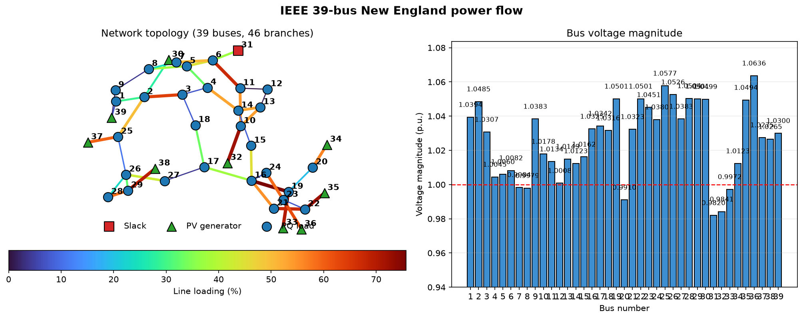

# 3.3 ~ 3.6　结果解读（二）：支路潮流、功率平衡与自检

> 线路负载率、潮流方向、有功无功平衡、结果图、自检清单

## 3.3 支路潮流

每条支路的结果有四个量：`PF`、`QF`（首端流入支路的有功/无功）、
`PT`、`QT`（末端流入支路的有功/无功）。

先看**负载率最高的 12 条**：

| # | from | to | P_from(MW) | Q_from(Mvar) | P_to(MW) | 容量(MVA) | 负载率% |
|---:|---:|---:|---:|---:|---:|---:|---:|
| 27 | 16 | 19 | -451.30 | -54.20 | 454.38 | 600 | **75.73** |
| 20 | 10 | 32 | -650.00 | -110.87 | 650.00 | 900 | 72.22 |
| 37 | 22 | 35 | -650.00 | -150.04 | 650.00 | 900 | 72.22 |
| 33 | 19 | 33 | -629.11 | -49.58 | 632.00 | 900 | 70.22 |
| 46 | 29 | 38 | -824.77 | 80.33 | 830.00 | 1200 | 69.17 |
| 35 | 21 | 22 | -604.42 | -87.26 | 607.21 | 900 | 67.47 |
| 13 | 6 | 11 | -322.65 | -38.85 | 323.38 | 480 | **67.37** |
| 3 | 2 | 3 | 319.91 | 88.59 | -318.58 | 500 | 63.98 |
| 39 | 23 | 36 | -558.57 | -22.35 | 560.00 | 900 | 62.22 |
| 41 | 25 | 37 | -538.34 | 65.45 | 540.00 | 900 | 60.00 |
| 38 | 23 | 24 | 353.84 | -0.50 | -351.31 | 600 | 58.97 |
| 45 | 28 | 29 | -347.61 | 28.76 | 349.16 | 600 | 58.19 |

### 怎么读

**① 负载率 = 视在功率 / 容量**

$$\text{负载率} = \frac{\max(|S_{\text{from}}|,\ |S_{\text{to}}|)}{\text{RATE\_A}} \times 100\%$$

本算例：**最大负载率 75.73%（支路 27，母线 16→19），平均 38.28%**。
超过 60% 的有 10 条：支路 3、13、20、27、33、35、37、39、41、46。

这些是**运行时需要重点关注的线路**。负载率接近 100% 就要考虑：
增加输电容量、调整发电计划、或者做 N-1 校验。

**② 符号表示潮流方向**

看支路 27（16→19）：`P_from = -451.30 MW`，`P_to = +454.38 MW`。
`PF` 为负说明**功率实际是从母线 19 流向母线 16**（和表中定义的 from/to 方向相反）。
`PT` 为正说明功率从母线 19 侧**流入**支路。

再看支路 3（2→3）：`P_from = +319.91`（正的，从 2 流向 3），
`P_to = -318.58`（负的，说明在 3 端是**流出**支路进入母线），功率确实从 2 送到 3。

**判据**：`PF > 0` → 实际潮流方向与 `F_BUS → T_BUS` 一致；
`PF < 0` → 方向相反。

**③ 有功损耗 = PF + PT**

```text
支路 27: -451.30 + 454.38 = 3.078 MW
支路 46: -824.77 + 830.00 = 5.234 MW
```

所有 46 条的损耗求和 = **43.6411 MW**，与发电负荷差额完全吻合（见 3.4 节）。

**④ 变压器支路的有功损耗为 0**

注意支路 5、14、20、37 的损耗正好是 0.000。原因是这几条变压器的
**`r = 0`**（纯电抗）。理想变压器 + 纯电抗不消耗有功，这是符合物理的。

支路 46（29→38）虽然是变压器，但 `r = 0.0008 ≠ 0`，所以有 5.234 MW 损耗。
它的电流很大（830 MW / 1.03 pu ≈ 8 pu），`I²R = 8² × 0.0008 ≈ 0.05 pu ≈ 5 MW`，
和结果吻合。

## 3.4 功率平衡：最有力的自检

```text
总发电有功  ΣPg =  6297.8711 MW
总负荷有功  ΣPd =  6254.2300 MW
网络有功损耗     =    43.6411 MW     （支路累加校验 43.6411 MW）

总发电无功  ΣQg =  1274.9390 Mvar
总负荷无功  ΣQd =  1387.1000 Mvar
网络无功损耗     =  -112.1610 Mvar   （支路累加校验 -112.1610 Mvar）
```

标幺值形式（除以 100 MVA）：

```text
ΣPg = 62.978711 pu
ΣPd = 62.542300 pu
损耗 =  0.436411 pu
```

### 有功平衡：很好理解

$$\underbrace{6297.8711}_{\text{发电}} - \underbrace{6254.2300}_{\text{负荷}} = \underbrace{43.6411}_{\text{网损}} \ \text{MW}$$

发电比负荷多 43.64 MW，这多出来的部分就是**电流流过线路电阻时发热损失的**。
损耗功率占负荷的 0.70%，属于正常水平（3% ~ 5% 以内都算健康）。

### 无功平衡：负的损耗，为什么？

$$\underbrace{1274.9390}_{\text{发电}} - \underbrace{1387.1000}_{\text{负荷}} = \underbrace{-112.1610}_{\text{"损耗"}} \ \text{Mvar}$$

**网络无功损耗是负的**——意味着网络整体在**发出**无功，而不是消耗。这不是错误，
而是 345 kV 高压输电网的正常特性。拆解一下：

```text
线路充电注入无功（电容效应）  =  1112.75 Mvar
支路总无功损耗 Σ(Qf+Qt)       =  -112.16 Mvar
串联电抗消耗无功（推算）      =  1224.92 Mvar
```

逻辑是这样的：

- 高压线路对地有**电容**（`b` 参数，本算例总充电电纳 Σb = 10.36 pu），
  电容**发出**无功。在 345 kV 下这个量很大：**1112.75 Mvar**。
- 线路串联**电抗**消耗无功（`I²X`）：**1224.92 Mvar**。
- 两者相抵：`1112.75 - 1224.92 = -112.16 Mvar`（网络净"损耗"）。

**所以负载侧少掉的 112.16 Mvar，由线路的电容补上了大部分。**
这也是为什么必须用**高压**输电：电压越高，同样的线路参数下电容补偿效应越强，
线路的无功损耗越小，输电效率越高。

> **初学者常见困惑**：看到无功损耗为负，第一反应是"我算错了"。
> 其实这是超高压网络的固有特性。检验方法很简单：看总充电电纳 Σb 是不是很大
> （本算例 10.36 pu，确实很大）。

## 3.5 图形化：一眼看懂结果

运行示例脚本会生成网络图（左：拓扑与线路负载率热力图；右：母线电压柱状图）：



### 左图：网络拓扑

- **红色方块** = 平衡节点（母线 31）
- **绿色三角** = PV 节点（母线 30、32 ~ 39），正好围成一个圈
- **蓝色圆点** = PQ 节点（母线 1 ~ 29）
- **线条颜色** = 线路负载率，从深蓝（0%）到深红（75.73%）

可以看到：**负载率高的线路（红橙色）集中在图的右下角**，也就是母线 16、
19、22、33、35 那一带——那里是负荷密集区，且连接着大容量发电机。

### 右图：母线电压幅值

- 红色虚线是 **1.00 pu** 参考线；
- 可以直观看到母线 31（0.9820）和 32（0.9841）偏低，
  母线 36（1.0636）和 25（1.0577）偏高；
- 所有母线都在 0.98 ~ 1.07 之间，**电压水平整体良好**。

## 3.6 结果自检清单

拿到任何潮流结果，先做这 4 项检查。**这能帮你抓出 90% 的低级错误**：

| # | 检查项 | 本算例结果 | 判据 |
|---:|---|---|---|
| 1 | 求解器是否收敛 | `success = True` | 必须为 True |
| 2 | 有功是否平衡 | `ΣPg - ΣPd = 43.6411 MW` | 应等于支路有功损耗累加值 |
| 3 | 无功是否平衡 | `ΣQg - ΣQd = -112.1610 Mvar` | 应等于支路无功损耗累加值 |
| 4 | 电压是否合理 | `0.9820 ~ 1.0636 pu` | 一般在 0.9 ~ 1.1 pu 内 |

如果第 2、3 项对不上，说明**结果没算完**（比如没做回算 `pfsoln`），
或者支路潮流没正确计算。

另外两项进阶检查：

| # | 检查项 | 本算例结果 |
|---:|---|---|
| 5 | 两求解器交叉验证 | PYPOWER vs 自研：2.2e-16 pu |
| 6 | 平衡机出力是否等于"负荷 + 损耗 - 其他机组" | `677.87 = 6254.23 + 43.64 - 5620` ✓ |


---

[← 结果解读：母线电压](06-results-voltage.md)　|　[返回目录](README.md)　|　[完整代码与运行 →](08-code.md)
